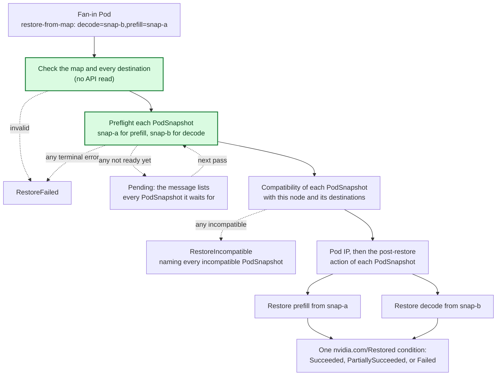

<!--
SPDX-FileCopyrightText: Copyright (c) 2026 NVIDIA CORPORATION & AFFILIATES. All rights reserved.
SPDX-License-Identifier: Apache-2.0
-->

# SNEP-942: Restore One Pod from Several PodSnapshots

Tracking issue: [#942](https://github.com/ai-dynamo/snapshot/issues/942).

<!-- toc -->
- [Summary](#summary)
- [Motivation](#motivation)
  - [Goals](#goals)
  - [Non-Goals](#non-goals)
- [Proposal](#proposal)
  - [User Stories](#user-stories)
    - [Story 1: A Prefill and Decode Pair in One Pod](#story-1-a-prefill-and-decode-pair-in-one-pod)
    - [Story 2: Replacing One Container's Snapshot](#story-2-replacing-one-containers-snapshot)
    - [Story 3: A Pod Created Before Its Snapshot Is Ready](#story-3-a-pod-created-before-its-snapshot-is-ready)
  - [Limitations, Risks, and Mitigations](#limitations-risks-and-mitigations)
- [Design Details](#design-details)
  - [Annotation](#annotation)
  - [Where the Annotation Is Checked](#where-the-annotation-is-checked)
  - [Preflight](#preflight)
  - [Restore](#restore)
  - [How the Pod Ends](#how-the-pod-ends)
  - [Restore Proxy and Nodes Without It](#restore-proxy-and-nodes-without-it)
  - [Agent Restart](#agent-restart)
  - [Changes by Component](#changes-by-component)
  - [Interaction with Other Designs](#interaction-with-other-designs)
    - [Cold-Start Fallback (SNEP-322)](#cold-start-fallback-snep-322)
    - [Restore Retry (SNEP-247)](#restore-retry-snep-247)
    - [Restore on Container Restart (SNEP-883)](#restore-on-container-restart-snep-883)
    - [Pod Groups (SNEP-324)](#pod-groups-snep-324)
    - [Node Cache (SNEP-644)](#node-cache-snep-644)
  - [API](#api)
  - [Security](#security)
  - [Performance and Scalability](#performance-and-scalability)
  - [Monitoring](#monitoring)
  - [Dependencies](#dependencies)
  - [Test Plan](#test-plan)
  - [Graduation Criteria](#graduation-criteria)
  - [Upgrade, Downgrade, and Version Skew](#upgrade-downgrade-and-version-skew)
- [Implementation History](#implementation-history)
- [Open Questions](#open-questions)
  - [Should a Pod Be Able to End Every Destination When One Fails?](#should-a-pod-be-able-to-end-every-destination-when-one-fails)
  - [Is 8 the Right Limit?](#is-8-the-right-limit)
  - [Should the Two Maps Converge?](#should-the-two-maps-converge)
  - [How Should Pod Groups Take Members with Several Containers?](#how-should-pod-groups-take-members-with-several-containers)
  - [Should Agents Say Which Restore Annotations They Support?](#should-agents-say-which-restore-annotations-they-support)
- [Alternatives](#alternatives)
- [Appendix](#appendix)
<!-- /toc -->

## Summary

A restore Pod can name a different `PodSnapshot` for each of its destination
containers with a new annotation, `nvidia.com/restore-from-map`. The node agent
checks every named `PodSnapshot`, restores all destination containers in
parallel, each from its own snapshot, and reports one `nvidia.com/Restored`
condition for the Pod. A Pod whose GPU containers were checkpointed one by one
can then be restored as one Pod. An example is a disaggregated inference server
whose prefill and decode workers share one Pod. A `PodSnapshot` still holds
exactly one container, and Pods that use `nvidia.com/restore-from` behave as
before.

## Motivation

A `PodSnapshot` checkpoints one container: `source.podRef.containers` takes
exactly one entry in `v1alpha1`. A restore Pod names one `PodSnapshot` in
`nvidia.com/restore-from`, and `nvidia.com/restore-container-map` can restore
that snapshot into several destination containers
([#113](https://github.com/ai-dynamo/snapshot/pull/113)). The restore side can
fan one snapshot out to several containers. It cannot bring several snapshots
into one Pod.

Some workloads are one Pod with several containers that each hold their own GPU
state. Disaggregated serving often runs a prefill worker and a decode worker as
two containers of one Pod, one GPU each. CPU sidecars, such as a router or a
metrics exporter, run next to them. The containers share the Pod's network
namespace and talk over localhost. They are scheduled together, and they live
and die together. Each GPU container can be checkpointed into its own
`PodSnapshot`, one after the other once
[#935](https://github.com/ai-dynamo/snapshot/issues/935) is fixed. No restore
Pod can take both snapshots, so such a workload has to leave its shared Pod to
use Snapshot.

[#847](https://github.com/ai-dynamo/snapshot/issues/847) restores prefill and
decode as separate instances, each in its own Pod. This proposal serves the
other deployment shape, where they share one Pod. It changes only the restore
side. Each container keeps its own `PodSnapshot`, which can be taken, reused,
or replaced on its own.

### Goals

1. A restore Pod restores several destination containers in parallel, each from
   a `PodSnapshot` that the Pod names.
2. Every check that a restore runs today runs for each named `PodSnapshot`: the
   `PodSnapshot` and its content, the snapshot's files on the node, the
   compatibility checks, and the post-restore action.
3. The Pod reports one outcome through the existing `nvidia.com/Restored`
   condition and reasons, and its messages name the `PodSnapshot` of each
   destination.
4. The change is additive. No CRD changes, and a Pod without the new annotation
   behaves exactly as today.
5. The per-container designs in flight (restore retry, cold-start fallback,
   restore on container restart, and the node cache) apply to each destination
   without changes of their own.

### Non-Goals

1. **A `PodSnapshot` with several containers.** `source.podRef.containers`
   keeps its limit of one entry.
2. **All-or-nothing restore.** When one destination fails, the others keep
   their restored workloads, as with fan-out today. An opt-in is an
   [open question](#should-a-pod-be-able-to-end-every-destination-when-one-fails).
3. **One consistent state across destinations.** Each destination restores from
   a snapshot taken on its own, at its own time. Connections, shared memory, and
   CUDA IPC handles between destinations are not restored as one state.
4. **Restore across Pods or nodes.** Every destination is in one Pod on one
   node. Coordinated multi-Pod restore is SNEP-324.
5. **Pod-group targets.** A Pod that a `PodGroupRestore` restores does not use
   the new annotation (see [Pod Groups](#pod-groups-snep-324)).

## Proposal

A restore Pod sets `nvidia.com/restore-from-map` instead of
`nvidia.com/restore-from`. Its value is a comma-separated list of
`destination=snapshot` pairs, as in this example:

```yaml
metadata:
  annotations:
    nvidia.com/restore-from-map: decode=decode-snapshot,prefill=prefill-snapshot
```

The target container of each named `PodSnapshot` restores into the destination
container on the left of its pair. Each destination meets the existing restore
Pod contract, with its own `snapshot-control` directory. The Pod's other
containers, such as a router, start normally and are left alone. This proposal
calls such a Pod a fan-in Pod, the counterpart of the fan-out Pod that
`restore-container-map` describes.

The node agent handles a fan-in Pod in two phases:

1. **Preflight, once per `PodSnapshot`.** The agent runs today's preflight for
   each named `PodSnapshot`, against the destinations that restore from it. A
   `PodSnapshot` that can never be restored ends the restore at once.
   Otherwise, a `PodSnapshot` that is not ready yet keeps the whole Pod
   waiting, and no destination starts before every snapshot is ready.
2. **Restore, once per destination.** The agent restores every destination in
   parallel, each from its own snapshot, with the code that restores the
   destinations of a fan-out Pod today. The `nvidia.com/Restored` condition sums
   up the destinations with the existing reasons.

The diagram shows a fan-in Pod with two destinations. Dashed arrows end the
restore or hold it.



The green steps are new. The steps after them are today's checks and today's
fan-out restore, run per `PodSnapshot` or per destination.

A destination whose restore fails ends as it does in a fan-out Pod: the agent
writes `restore-failed` into its control directory and kills it. Destinations
that restored keep running, and the Pod reports `RestorePartiallySucceeded`.

### User Stories

#### Story 1: A Prefill and Decode Pair in One Pod

A team serves a model with disaggregated prefill and decode. Each replica is one
Pod on a two-GPU node: a `prefill` container and a `decode` container with one
GPU each, and a CPU `router` container in front of them. The team checkpoints
`prefill` and `decode` from one source Pod, one after the other, into two
`PodSnapshot`s.

Today no restore Pod can take both snapshots. With this proposal, the replica's
Pod template sets
`nvidia.com/restore-from-map: prefill=prefill-snapshot,decode=decode-snapshot`.
The agent restores both containers in parallel, the router starts as usual, and
the replica serves after one restore instead of two model loads.

#### Story 2: Replacing One Container's Snapshot

The team changes the decode worker's configuration, which needs a new
snapshot of `decode` only. It checkpoints `decode` into `decode-snapshot-v2`
and points the map's `decode` entry at it. The prefill snapshot stays as it is.
With a `PodSnapshot` that held both containers, the team would have to
checkpoint both again.

#### Story 3: A Pod Created Before Its Snapshot Is Ready

The team's controller creates replicas while `decode-snapshot-v2` is still
being taken. The NRI plugin needs no API read to find a fan-in Pod's
destinations, so the containers start, and their restore proxies wait. The
Pod's condition says `SnapshotPending` and names `decode-snapshot-v2`. Once it
is Ready, both destinations restore.

### Limitations, Risks, and Mitigations

- **A partial restore can leave a Pod that is useless.** When one destination
  fails, the Pod reports `RestorePartiallySucceeded` and the restored siblings
  keep running, as in a fan-out Pod. A pair that only works whole then holds
  its GPUs until something notices. The condition is terminal and
  `podcontract.ClassifyRestoreOutcome` reports it, so an owner can delete the
  Pod. A liveness probe that checks the whole unit, such as the router's view of
  both workers, ends it too. Restore retry (SNEP-247) makes a failure that does
  not recur cost an attempt instead of the Pod. An opt-in to end every
  destination is an
  [open question](#should-a-pod-be-able-to-end-every-destination-when-one-fails).
- **State between destinations is not consistent.** Each `PodSnapshot` is taken
  on its own, at its own time. Consider a connection from prefill to decode over
  localhost, a shared memory segment, or a CUDA IPC handle between them. Each
  would be restored from two different moments, or on one side only. Multi-GPU
  support covers memory shared by processes in one container, not across
  containers. To avoid this, checkpoint each container before it connects to its
  siblings, and let it connect after the restore. The post-restore action
  (SNEP-411) or the workload's own restore hook can start that. #847 does the
  same for its KV transfer, whose agent starts after the restore. The restore
  Pod contract states this rule.
- **Older node agents ignore fan-in Pods.** An agent that does not know the
  annotation sees no restore request. It installs no restore proxy and writes
  no condition, so each destination runs its own command. With the source's
  command, that is a cold start nobody asked for. With an inert command, the
  container waits forever. Upgrade node agents before creating fan-in Pods (see
  [Upgrade, Downgrade, and Version Skew](#upgrade-downgrade-and-version-skew)).
- **More parallel restores per Pod.** A fan-in Pod with eight destinations runs
  eight restores at once on its node, each reading a different snapshot. The
  limit of 8 bounds it. PageBroker refuses restores past its per-node limits,
  and restore retry (SNEP-247) tries those destinations again.
- **Two map directions.** `restore-container-map` reads `source=destination`,
  and `restore-from-map` reads `destination=snapshot`. A reversed entry fails
  validation (see [Annotation](#annotation)), and the API reference states each
  direction.

## Design Details

### Annotation

`nvidia.com/restore-from-map` follows these rules:

| Rule | Behavior |
| --- | --- |
| Format | Comma-separated `destination=snapshot` pairs. Whitespace around entries and names is ignored, as in `restore-container-map`. |
| Destination | The name of a container in the Pod's `spec.containers`. Each destination appears once. |
| Snapshot | The name of a `PodSnapshot` in the Pod's namespace. Several destinations can name the same `PodSnapshot`, which then restores into each of them, as in fan-out. |
| Entries | 1 to 8 (`podcontract.MaxSnapshotMappings`). An empty value, an empty entry, and a trailing comma are invalid. |
| Other restore annotations | A Pod that also sets `restore-from` or `restore-container-map` is invalid, whatever their values. A pod-group target, which carries the `nvidia.com/restore-group` scheduling gate or the `nvidia.com/restore-group-uid` binding, is invalid too. |
| Destination contract | Each destination mounts `snapshot-control` with `subPath` equal to its name and sets `SNAPSHOT_CONTROL_DIR`, as the restore Pod contract requires today. |

Presence is what counts, as for `restore-from` today. A Pod with an empty
`restore-from-map` asks for a restore, and the restore fails validation.

`podcontract.Build` writes the entries sorted by destination, so equivalent
requests build the same Pod. `podcontract.Validate` compares the annotation
with a request as a set, and the order of entries does not matter.

A map with one entry is valid. It restores like `restore-from` with a one-pair
`restore-container-map`, except that the NRI plugin needs no API read to find
the destination.

**Direction.** The pairs read `destination=snapshot`, the reverse of
`restore-container-map`'s `source=destination`. Each destination has exactly
one source, so the destination is the key, and each entry reads "this container
restores from that snapshot". Mirroring `restore-container-map` would repeat the
key whenever two destinations share a `PodSnapshot`. A reversed entry does not
pass unnoticed: its left side must name a container of the Pod, so
`prefill-snapshot=prefill` fails with
`restore pod has no destination container named "prefill-snapshot"`.

**Limit.** Each entry is a restore that runs in parallel with the others on one
node, and the preflight reads each distinct `PodSnapshot` and its content on
every pass. Eight is the number of GPUs on a common GPU node, so a Pod with one
GPU per destination fits. Raising the limit later breaks no Pod, while lowering
it would. `restore-container-map` keeps no limit.

### Where the Annotation Is Checked

Snapshot has no admission check for restore Pods. Each reader checks the
annotation itself, as each checks `restore-from` today:

| Reader | With an invalid annotation |
| --- | --- |
| `podcontract.Build` and `podcontract.Validate` | Return an error. `Build` also refuses a Pod that already carries another restore annotation or a different map. |
| Node agent | Fails the restore with `RestoreFailed` before any API read, with the cause in the message. |
| NRI plugin | Fails container creation, and kubelet retries it with backoff. The agent's condition gives the cause. |
| Operator | Refuses a `SnapshotJob` whose Pod template sets the annotation, as it refuses the other two restore annotations. [#875](https://github.com/ai-dynamo/snapshot/issues/875) would refuse it at admission. |
| `snapshotctl restore` | Refuses the manifest before it creates the Pod. |

### Preflight

The agent runs these steps on every pass, in this order:

1. **The Pod.** The agent parses the map and checks every destination against
   the restore Pod contract. This needs no `PodSnapshot`, so a broken Pod fails
   at once, before any API read. A `restore-from` Pod is checked later, after
   its `PodSnapshot` is read, since its destinations depend on the target
   container.
2. **Each `PodSnapshot`.** The agent runs today's checks once for each distinct
   `PodSnapshot`, even when several destinations name it. It checks the
   `PodSnapshot` and its bound content, exactly one target container, and the
   snapshot's files on this node.
3. **Terminal before pending.** If any `PodSnapshot` can never be restored, the
   restore fails at once, even while another one is still pending. Waiting
   cannot help a `PodSnapshot` that failed, is being deleted, has a stale
   binding, or has Ready content without files.
4. **Pending.** Otherwise, if any `PodSnapshot` is not ready yet, the whole Pod
   waits. The condition takes the reason of the first pending `PodSnapshot`
   (`SnapshotPending`, `ContentPending`, or `ArtifactPending`). The message
   lists every pending one with its destinations.
5. **Compatibility.** The agent compares each `PodSnapshot` with this node and
   with its own destinations. If any is incompatible, it refuses the Pod with
   one `RestoreIncompatible` condition that names every incompatible
   `PodSnapshot` and its mismatches. `nvidia.com/snapshot-skip-compat-check`
   applies to the whole Pod.
6. **Pod IP.** When the agent restores established TCP connections, which is
   the default, it waits once for the Pod's IP, as today.
7. **Post-restore action.** Each `PodSnapshot` brings the post-restore action
   saved with it (SNEP-411). The agent checks it against that `PodSnapshot`'s
   destinations.

For each `PodSnapshot`, the order of today's checks stays the same. Only the
contract check moves first.

The messages below are examples. The first one shows a Pod that waits for one
of its `PodSnapshot`s. The second shows a Pod refused for both of its
`PodSnapshot`s.

```text
PodSnapshot decode-snapshot-v2 (decode): Waiting for PodSnapshot serving/decode-snapshot-v2 to become Ready
Refused restore; this node cannot run the checkpoint: PodSnapshot prefill-snapshot (prefill): cpu-arch: source amd64, target arm64; PodSnapshot decode-snapshot (decode): cpu-arch: source amd64, target arm64
```

A later pass repeats the preflight, as it does for `restore-from`. A
`PodSnapshot` that is deleted or fails while some destinations are still
pending ends the restore, as it does for `restore-from` today.

### Restore

After the preflight, the agent adds its restore finalizer to the Pod once and
sets `RestoreInProgress`. It then starts one worker per destination, as it does
for a fan-out Pod. Each worker restores from its own destination's snapshot:
its content UID, its target container's name, its files, and its post-restore
action. Everything else is today's per-destination restore:

- The inspect gate runs per destination. A destination it refuses counts as not
  restored.
- `config.restore.timeoutSeconds` bounds each destination's restore.
- Every destination restores into the same Pod IP. As today, the established
  TCP connections of each destination move from its source Pod's IP to it.
- Each worker writes `restore-complete` or `restore-failed` into its own control
  directory, and the restore proxy of that destination follows it.

The outcome uses the existing reasons, counted over destinations as today:

| Reason | When |
| --- | --- |
| `RestoreInProgress` | A destination is still pending. |
| `RestoreSucceeded` | Every destination restored. |
| `RestorePartiallySucceeded` | Some destinations restored, and others failed or were refused. |
| `RestoreFailed` | No destination restored, and at least one failed. |
| `RestoreIncompatible` | Every destination was refused. |

The messages name each destination's `PodSnapshot` where a `restore-from` Pod's
messages name its one `PodSnapshot`. Messages of `restore-from` Pods do not
change. These are examples:

```text
Restoring 2 destination container(s) from PodSnapshots prefill-snapshot (prefill), decode-snapshot (decode)
Restored 2 destination container(s) from PodSnapshots prefill-snapshot (prefill), decode-snapshot (decode): prefill, decode
Restored 1 of 2 destination containers from PodSnapshots prefill-snapshot (prefill), decode-snapshot (decode); not restored: decode: <cause>
```

### How the Pod Ends

Each outcome leaves the destination containers as the table shows. A partial
restore follows fan-out, and nothing in this proposal ends a destination that
restored.

| Outcome | `nvidia.com/Restored` | Destination containers |
| --- | --- | --- |
| Every destination restored | `True`, `RestoreSucceeded` | Run their restored workloads. |
| Some restored, some failed | `False`, `RestorePartiallySucceeded` | A failed one gets `restore-failed` and is killed. A restored one keeps running. |
| Every destination failed | `False`, `RestoreFailed` | Each gets `restore-failed` and is killed. |
| A `PodSnapshot` this node cannot run | `False`, `RestoreIncompatible` | None is restored. Today they keep waiting; #941 proposes ending each one. |
| A terminal preflight error | `False`, `RestoreFailed` | Same as the row above. |
| A `PodSnapshot` that is not ready | A pending reason | Every destination waits. #941 proposes a bound. |
| An invalid map, on a node with the restore proxy | `False`, `RestoreFailed` | No container of the Pod is created. kubelet retries until the Pod is deleted. |

A destination that ended does not restore again. With `restartPolicy: Never` it
stays terminated. With `Always` or `OnFailure`, kubelet starts it again, and
its restore proxy finds `restore-failed` and exits with code 112. With
`restartPolicy: Never`, the Pod turns `Failed` only when all its containers
have ended. A restored sibling or a sidecar keeps it `Running`, and its owner
deletes it.

[#941](https://github.com/ai-dynamo/snapshot/issues/941) proposes ending a
restore that will not run like a failed one, and a bound on the wait for a
`PodSnapshot`. For a fan-in Pod, it ends every destination of the map,
including those whose `PodSnapshot` was fine. Its bound counts from the start
of the first destination container and applies while any `PodSnapshot` is not
ready.

### Restore Proxy and Nodes Without It

Every destination of a fan-in Pod is on one node. Either all of them get the
restore proxy, or none does.

**With the proxy.** The NRI plugin takes the destinations from the annotation,
with no API read, and makes the proxy PID 1 of each one. A fan-in Pod can
therefore be created before its `PodSnapshot`s exist. A `restore-from` Pod
without `restore-container-map` cannot: the plugin reads its `PodSnapshot` to
find the target container, and container creation fails until it exists. The
plugin leaves the Pod's other containers alone. Each proxy waits in its own
control directory, follows its own restored process, and uses the exit codes
112 and 113 as today.

**Without the proxy.** A node runs without the proxy when its runtime has no
NRI or NRI older than v0.10, or when the install turns the proxy off. There the
agent restores each destination beside the container's own command. The
restore Pod contract's rules for such nodes then apply to each destination.
Each one needs an inert, long-running command and a liveness probe that checks
the workload. A failed destination is killed, and if it starts again, it runs
the inert command without a restore.

A Pod spec with inert commands in its destinations works on both kinds of node.
On a node with the proxy, the proxy replaces them.

### Agent Restart

Fan-out already handles each destination on its own, and fan-in needs nothing
new:

- `RestoreInProgress` on the Pod makes every worker check its own
  `restore-complete` before any restore work. A destination that completed is
  not restored again, and its post-restore action resumes.
- Each destination has its own control directory, so sentinels and the proxy
  binary never collide. `podcontract.Validate` rejects a shared `subPath`.
- The finalizer, the record of a handled restore, and the start reports of the
  NRI plugin are kept per Pod, or per Pod UID and container, as today.

### Changes by Component

The change touches these components:

| Component | Change |
| --- | --- |
| `api/podcontract` | The annotation, `SnapshotMapping`, `MaxSnapshotMappings`, `Request.SnapshotMappings`, `RestoreRequested`, `SnapshotMappingsFromAnnotations`, and `ValidateSnapshotMappings`. `Build` and `Validate` accept either request form. `GetRestoreFromSnapshotName` rejects a Pod that also sets the map. `BuildGroupTarget`, `ClaimGroupTarget`, and `RestoreGroupClaimOf` reject the map once the pod-group API lands. |
| Node agent | The restore queue takes Pods with either annotation. The preflight runs per `PodSnapshot`. The plan holds one source per `PodSnapshot`, and each worker takes its destination's source. `RestoreDestinations` reads the map without an API read. |
| NRI plugin | Acts on Pods with either annotation. |
| Operator | The source Job check rejects the annotation. #875's admission rule covers it. |
| `snapshotctl restore` | Reads the map from the manifest. `--snapshot` is then omitted. It checks that each `PodSnapshot` exists and has one target container, and prints them comma-separated. |
| e2e helpers | Strip the annotation from source Pods, like the other two. |
| Docs | A row in the API reference, a section in the restore Pod contract, the CLI reference, a limitations bullet for partial restores, and a CHANGELOG entry. |

The CRDs, PageBroker, the restore proxy, the executor, and the chart do not
change.

### Interaction with Other Designs

Each design below acts per destination container. None of them needs more from
this proposal than the `PodSnapshot` of a destination, which the agent reads
from the map.

#### Cold-Start Fallback (SNEP-322)

[SNEP-322](https://github.com/ai-dynamo/snapshot/pull/800) falls back per
destination. It writes `trigger-cold-start` into the control directory of the
destination that failed for good, kills that container, and lets the NRI plugin
start the next one without the proxy. A fan-in Pod sets the policy once, for
the Pod, and the agent applies it to each destination.

- **Mixed Pods.** A fan-in Pod can end with some destinations restored and
  others started cold. A workload whose containers must all start the same way
  should not opt in until the
  [open question](#should-a-pod-be-able-to-end-every-destination-when-one-fails)
  is settled.
- **Failures before any restore.** A refusal or a terminal preflight error
  comes before any destination restores. Where fallback applies to it, it
  applies to every destination of the map.
- **A missing snapshot.** The NRI plugin creates a fan-in Pod's containers
  without its `PodSnapshot`s, so the wait is in the agent's preflight
  (`SnapshotPending`), visible on the Pod. A bound on that wait, as #941
  proposes for SNEP-322's open question, fails every destination together.
- **Nodes without the proxy.** No fallback, as SNEP-322 states for any Pod.

#### Restore Retry (SNEP-247)

[SNEP-247](https://github.com/ai-dynamo/snapshot/pull/836) and its
implementation stack (#895 to #906) keep their state per destination. Each
control directory holds a `restore-attempts` record, each destination has one
deadline, and the `nvidia.com/restore-retry-status` annotation is keyed by
container. A fan-in Pod uses them unchanged.

- `nvidia.com/restore-retry-limit` applies to every destination of the Pod.
- A pending `PodSnapshot` holds every destination before its first attempt, so
  none spends an attempt or time.
- A fresh-container retry kills only the destination that failed. Its siblings
  keep running.
- The `RestoreRequested` event of each attempt already names the destination
  and its `PodSnapshot`.
- `RestorePartiallySucceeded` comes only after the failed destination has used
  its retries.
- #906, if accepted, restores a destination that started again from its own
  `PodSnapshot`. Its `RestoreRepeated` event reads the name from `restore-from`
  today, and would take the destination's entry of the map instead.

The stack and fan-in change the same functions: `restorePodContainers`,
`restoreDestination`, and `runRestore`. Fan-in picks each destination's
snapshot when it creates the restore operation, and the stack's attempt event
already reads the snapshot from that operation. Whichever lands second rebases.

#### Restore on Container Restart (SNEP-883)

[SNEP-883](https://github.com/ai-dynamo/snapshot/pull/884) restores a
replacement container "from the same snapshot". For a fan-in Pod, that is the
`PodSnapshot` of the replacement's destination, read from the map.

- **Eligibility.** SNEP-883 requires the Pod's previous restore cycle to have
  succeeded. A fan-in Pod that ended `RestorePartiallySucceeded` is not
  eligible, as for any Pod.
- **Restore state.** Its `nvidia.com/restore-container-state` record is keyed by
  container name, and each attempt targets one content UID. In a fan-in Pod,
  each destination's attempt targets the content of its own `PodSnapshot`.
- **Control directories.** SNEP-883 moves each destination to a directory per
  container ID, `snapshot-control/<destination>/<container-id>/`. Fan-in
  already gives every destination its own directory and follows whatever the
  contract becomes.
- **Changing the source.** SNEP-883 leaves a change of the restore source out of
  scope. Pod annotations can be edited, and a replacement restore would read
  the map again. This proposal treats the map like `restore-from`: changing it
  after the restore started is unsupported. If SNEP-883 wants a guard, its
  record could pin each destination's content UID.

#### Pod Groups (SNEP-324)

The pod-group design is
[SNEP-324](https://github.com/ai-dynamo/snapshot/pull/325), with its API in
[#612](https://github.com/ai-dynamo/snapshot/issues/612) and
[#811](https://github.com/ai-dynamo/snapshot/pull/811) and the agent's part in
[#934](https://github.com/ai-dynamo/snapshot/pull/934). It restores one member
snapshot into one container of each target Pod. Every field that names
containers is capped at one entry. The operator claims a target by writing
`nvidia.com/restore-group-uid` and a one-pair `restore-container-map`, and the
agent and the NRI plugin dispatch on that binding first.

This proposal keeps fan-in to Pods restored on their own:

- `BuildGroupTarget` and `ClaimGroupTarget` refuse a Pod with
  `restore-from-map`, as they refuse `restore-from`.
- `RestoreGroupClaimOf` returns an error for a bound Pod that carries the map,
  as it does for `restore-from`.
- `podcontract.Build` with `SnapshotMappings` refuses a Pod that carries the
  group gate or binding.

A group member with several containers is out of the group design's scope
today. SNEP-324 expects to support it by relaxing its caps once a `PodSnapshot`
can hold several containers. A member could instead have one `PodSnapshot` per
container, with the operator projecting a destination-to-snapshot map onto the
target as this annotation does. This proposal does not choose between the two.
Its parser and its preflight per `PodSnapshot` would be the per-Pod part of the
second.

#811 reshapes `podcontract.Build` around destination names, and #934 adds a
group branch to the restore queue and the NRI plugin. Fan-in touches the same
functions. If those land first, fan-in rebases onto them.

#### Node Cache (SNEP-644)

[SNEP-644](https://github.com/ai-dynamo/snapshot/pull/918) keeps one local copy
per `PodSnapshotContent` UID and container,
`artifacts/<snapshot-uid>/containers/<container>/`. Each destination of a
fan-in Pod checks the cache for its own snapshot. Two destinations that name one
`PodSnapshot` share one copy. The choice between the local copy and S3 is made
per destination, and preheat works per snapshot as before. On a cache miss, a
fan-in Pod downloads several snapshots at once, which preheat avoids.

### API

No CRD, condition type, condition reason, event reason, Helm value, or agent
setting is added. This annotation is new:

| Annotation | Description |
| --- | --- |
| `nvidia.com/restore-from-map` | Instead of `restore-from` and `restore-container-map`. Comma-separated `destination=snapshot` pairs, at most 8: each destination container restores from its own `PodSnapshot` in the Pod's namespace. |

`api/podcontract` gains these names. All of them are additive:

```go
const RestoreFromMapAnnotation = "nvidia.com/restore-from-map"
const MaxSnapshotMappings = 8

type SnapshotMapping struct {
	Destination  string
	SnapshotName string
}

// Request gains one field. A request sets it, or SnapshotName,
// SourceContainer, and Mappings, never both.
type Request struct {
	SnapshotName     string
	SourceContainer  string
	Mappings         []ContainerMapping
	SnapshotMappings []SnapshotMapping
}

func RestoreRequested(annotations map[string]string) bool
func SnapshotMappingsFromAnnotations(annotations map[string]string) ([]SnapshotMapping, error)
func ValidateSnapshotMappings(mappings []SnapshotMapping) error
```

A `SnapshotMapping` names no source container: each `PodSnapshot` has exactly
one target container. `ClassifyRestoreOutcome` does not change. A consumer that
finds restore Pods by `restore-from` should use `RestoreRequested`.

`snapshotctl restore` makes `--snapshot` optional when the manifest sets the
map, and prints the `PodSnapshot`s comma-separated in its `pod_snapshot` field.

The restore Pod contract gains one section. Its rule "a Pod gets one restore"
holds per destination.

### Security

- **Namespaces.** Every `PodSnapshot` in the map is in the Pod's namespace, as
  for `restore-from`. Whoever can create a Pod in a namespace can already
  restore any `PodSnapshot` in it.
- **Permissions.** The agent's RBAC does not change. It reads at most eight
  `PodSnapshot`s and their contents per pass instead of one.
- **Isolation.** Each destination keeps its own control directory, and
  `podcontract.Validate` rejects a shared `subPath`. One destination's sentinels
  cannot reach another's.
- **Parsing.** The NRI plugin parses the annotation inside the runtime's
  container creation call, with no API read. Kubernetes caps a Pod's annotations
  at 256 KiB in total, and an invalid value fails creation.
- **Resource use.** A Pod restores at most eight destinations. The GPUs they use
  are the ones the Pod requests, as for any restore.

### Performance and Scalability

- **Preflight.** Each pass reads each distinct `PodSnapshot`, its content, and
  its manifest, so a map of eight distinct snapshots reads eight of each. A
  pending Pod is checked again on its next update or after 30 seconds, as
  today.
- **Restore.** A fan-in Pod with N destinations runs N restores in parallel, as
  a fan-out Pod with N destinations does. Fan-out reads one snapshot N times.
  Fan-in reads N different snapshots, so the store serves more data, and the
  Pod is ready when its slowest destination is.
- **Container creation.** The NRI plugin needs no API read for a fan-in Pod. A
  `restore-from` Pod without a container map spends up to one second of the
  runtime's call on that read.

### Monitoring

- **Condition.** `nvidia.com/Restored` with the existing reasons. Its messages
  name each destination's `PodSnapshot` (see [Restore](#restore)).
- **Events.** The existing events on the restore Pod. The per-destination
  `RestoreRequested` event already names that destination's `PodSnapshot`. No
  event reason is added.
- **Logs.** The agent's startup line names both restore annotations. Preflight
  and restore logs name the `PodSnapshot` and the destination.
- **Metrics.** None. The agent has no metrics endpoint, and metrics follow
  [#665](https://github.com/ai-dynamo/snapshot/issues/665).

### Dependencies

No new dependency. Fan-in builds on fan-out (#113) and the restore Pod
contract. Checkpointing several containers of one source Pod one after the
other needs #935. The proposal coordinates with #811 and #934, the SNEP-247
stack, SNEP-322, SNEP-883, #875, and #941, as described in
[Interaction with Other Designs](#interaction-with-other-designs).

### Test Plan

Tracking: #942.

**Unit.** An implementation exists with these tests, and it changes no
existing test:

- `api/podcontract`: parsing of whitespace, a shared `PodSnapshot`, an empty
  value, a missing or extra `=`, a trailing comma, invalid names, and a
  duplicate destination. The limit, with 8 accepted and 9 refused. Mixing with
  `restore-from` (also when empty) or `restore-container-map`.
  `RestoreRequested`, and `GetRestoreFromSnapshotName` refusing a mixed Pod.
- `Build` and `Validate`: the sorted annotation, idempotence, an untouched
  input, the shape of each destination, a sidecar left alone, and a round trip
  with reordered entries. Conflicts with either other annotation or a different
  map, and drift of the annotation, a control mount, or the environment.
- Agent preflight: two Ready `PodSnapshot`s, each read once, with its own files,
  target container, and post-restore action. A shared `PodSnapshot` read once.
  One pending in each of four ways, and both pending, with no finalizer added.
  One failed while the other is pending. Ready content without files. One
  incompatible. Invalid Pods failing before any API read.
- Agent restore: both destinations restored concurrently from their own
  content. One failed, with only its container killed, and both failed. After
  an agent restart, only the destination without `restore-complete` restored.
  The messages of each outcome.
- NRI plugin: each destination gets the proxy in its own control directory,
  and the sidecar does not. Operator: the source Job check. `snapshotctl`: a
  request from `--snapshot` or from the manifest's map, and its errors.

**Unit, new for this proposal.** The refusal that names every incompatible
`PodSnapshot`. The pod-group refusals in `BuildGroupTarget`,
`ClaimGroupTarget`, and `RestoreGroupClaimOf`. #875's admission rule refusing
the annotation.

**End to end.** Next to `test_one_cpu_snapshot_restores_into_two_containers`
in the CPU suite (`make cpu-e2e`):

- Two CPU containers of one source Pod, checkpointed one after the other, and
  restored into one Pod with a sidecar. Both workloads resume with their own
  state.
- The same Pod created before one of its `PodSnapshot`s exists. It reports
  `SnapshotPending` and restores once the snapshot is Ready.
- One destination's snapshot damaged, as the existing damaged-snapshot test
  does. The Pod reports `RestorePartiallySucceeded`, and only that container
  ends.
- A Pod that sets both `restore-from-map` and `restore-from` reports
  `RestoreFailed`.

On a GPU node, a Pod with two single-GPU destinations from two `PodSnapshot`s,
with and without the restore proxy. Inference from each destination matches
its source.

### Graduation Criteria

**Alpha.** The annotation, the agent, the NRI plugin, `podcontract`,
`snapshotctl`, and the docs, with unit tests and the CPU end-to-end tests.
The upgrade order is documented.

**Beta.** The GPU end-to-end test passes with and without the proxy. The open
questions are decided. Composition with restore retry, cold-start fallback, and
restore on container restart is tested for each one that has landed. The
pod-group refusals are in place.

**GA.** Production use on more than one installation, and the annotation's
format and limit unchanged for one release.

### Upgrade, Downgrade, and Version Skew

- **Upgrade.** Roll out node agents first, then create fan-in Pods. The agent
  and its NRI plugin ship in one image, so they never disagree on a node. The
  CHANGELOG states the order.
- **Version skew.** An agent that predates this proposal ignores a fan-in Pod
  on its node. The Pod gets no condition and no restore proxy, and each
  destination runs its own command. The missing condition is the only sign.
  [Open Questions](#should-agents-say-which-restore-annotations-they-support)
  asks whether agents should say what they support.
- **Downgrade.** Delete fan-in Pods that have not finished their restore before
  rolling agents back. An older agent fails the restore of such a Pod once it
  carries the restore finalizer, since the Pod names no `restore-from`. It
  ignores one that has no finalizer yet. A fan-in Pod whose restore finished
  keeps running.
- **Go API.** All additions are additive. `Request` gains a field, so code
  that builds it with positional struct literals stops compiling. Keyed
  literals are unaffected.

## Implementation History

- 2026-11-11: implemented on a fork based on v0.3.0
  ([commit `c297601a`](https://github.com/fishaudio/snapshot/commit/c297601a6e26372a0fddf25ad60444865aa7ca34),
  22 files). The fork runs it on RTX 5090 nodes, without the restore proxy, for
  Pods with two single-GPU inference containers. The NRI plugin path is covered
  by unit tests only.
- 2026-11-16: tracking issue #942 opened.

This proposal differs from that commit in these points:

- **Refusal.** The proposal refuses with every incompatible `PodSnapshot` in
  the message. The commit refuses at the first one.
- **Pod groups.** The proposal refuses the map on a pod-group target. The
  commit predates #811 and #934.
- **`SnapshotJob` admission.** The proposal adds the annotation to #875's rule.
  The commit adds it only to the operator's source Job check.
- **Docs.** The proposal follows the layout of #786 and adds the rule about
  state between destinations to the restore Pod contract. The commit edits the
  pages of v0.3.0.

## Open Questions

### Should a Pod Be Able to End Every Destination When One Fails?

A prefill and decode pair is useless in part, but fan-out keeps restored
destinations running when a sibling fails. The options are:

- **A: keep fan-out's behavior (proposed for alpha).** The owner, or a liveness
  probe on the whole unit, ends the Pod.
- **B: an opt-in to end every destination.** When one destination fails for
  good, after its retries, the agent writes `restore-failed` into every
  destination and kills each one.
- **C: fall back together.** With SNEP-322 on, a destination that fails for
  good makes every destination of the Pod start cold.

B and C both depend on when a failure is final, which SNEP-247 and SNEP-322
define. This proposal suggests deciding after they settle.

### Is 8 the Right Limit?

The options are 8, which can grow later without breaking Pods, no limit, as
`restore-container-map` has, or a cluster-wide setting. This proposal keeps 8
until a workload needs more.

### Should the Two Maps Converge?

`restore-container-map` maps one snapshot to destinations, and
`restore-from-map` maps destinations to snapshots, in opposite directions. A
later API version could replace both with one structured restore request, such
as a list of destinations, each with its source.

### How Should Pod Groups Take Members with Several Containers?

This is for SNEP-324's authors to decide. A member could have one `PodSnapshot`
with several containers. It could instead have one `PodSnapshot` per container,
projected onto the target as a map like this one (see
[Pod Groups](#pod-groups-snep-324)).

### Should Agents Say Which Restore Annotations They Support?

An older agent ignores a fan-in Pod without a trace. The pod-group design lists
the protocols each agent supports in
`nvidia.com/snapshot-podgroup-protocols` on the agent Pods, and its controllers
place work by it. Restore Pods are placed by their owners, so a similar list
would help an owner check a node before using it, not steer the scheduler.

## Alternatives

**A `PodSnapshot` with several containers.** Lifting the one-container limit of
`source.podRef.containers` changes the CRD and the snapshot's layout, which has
a large compatibility surface. It also couples the containers' snapshots, so
they can no longer be taken, reused, or replaced on their own (Story 2).

**`restore-from` as a default, with overrides per destination.** It is shorter
for "every destination but one from snapshot A". Every reader would have to
merge two annotations, and a mistake in one would silently change the meaning
of the other.

**One annotation per destination**, such as
`nvidia.com/restore-from.<container>`. Each entry would need no parsing.
Readers would have to scan every annotation of the Pod instead of checking one
key. The mixing rules and the limit get harder to state. The name part of an
annotation key is limited to 63 characters, which a container name can use up
on its own.

**`snapshot=destination`**, mirroring `restore-container-map`. Both maps would
read in one direction. The key would repeat whenever two destinations share a
`PodSnapshot`, and an entry would no longer read as "this container restores
from that snapshot".

**One restore Pod per container.** It works today. It gives up the shared
network namespace and the co-scheduling, and it needs another layer to keep the
pieces together. #847 serves workloads built that way.

**Take this into the pod-group design (#324).** Two forms were considered:

- **Restore the Pod as a group whose targets share it.** A group target is a
  Pod, one per member, and members are told apart by Pod IP for the TCP remap.
  Two members in one Pod would share an IP. A group also needs the coordinator,
  the scheduling gate, and the operator's claim, none of which a single Pod on
  one node needs.
- **Wait until groups support members with several containers.** Groups cap
  every container list at one entry, and SNEP-324 ties lifting the cap to a
  `PodSnapshot` with several containers. A standalone Pod would still need the
  group machinery to restore.

Fan-in stays a standalone restore. It does not rule out either form later, and
its preflight per `PodSnapshot` could serve a group member with several
containers.

**A restore request resource** that names a source per destination. The restore
interface is a set of annotations on a Pod. The NRI plugin decides from them
without an API read, and any owner can restore from a Pod template. A new kind
would need an operator path, RBAC, and a lifecycle of its own. A later API
version may still want one (see
[Should the Two Maps Converge?](#should-the-two-maps-converge)).

## Appendix

- [#942](https://github.com/ai-dynamo/snapshot/issues/942): the tracking issue.
- [#113](https://github.com/ai-dynamo/snapshot/pull/113): parallel restore into
  several destination containers (fan-out).
- [#935](https://github.com/ai-dynamo/snapshot/issues/935): checkpointing a
  second container of a Pod.
- [#847](https://github.com/ai-dynamo/snapshot/issues/847): prefill and decode
  restored as separate instances.
- [SNEP-322](https://github.com/ai-dynamo/snapshot/pull/800): cold-start
  fallback. [SNEP-247](https://github.com/ai-dynamo/snapshot/pull/836): restore
  retry, with its stack #895 to #906.
  [SNEP-883](https://github.com/ai-dynamo/snapshot/pull/884): restore on
  container restart.
- [SNEP-324](https://github.com/ai-dynamo/snapshot/pull/325), #612, #811, and
  #934: pod groups.
- [SNEP-644](https://github.com/ai-dynamo/snapshot/pull/918): node cache.
- [#875](https://github.com/ai-dynamo/snapshot/issues/875): restore annotations
  on a `SnapshotJob`. [#941](https://github.com/ai-dynamo/snapshot/issues/941):
  ending a restore that will not run.
- [SNEP-411](../411-application-lifecycle-hooks/README.md): the post-restore
  action.
- [Restore Pod Contract](../../reference/restore-pod-contract.md) and
  [Naming Conventions](../../development/naming.md).
